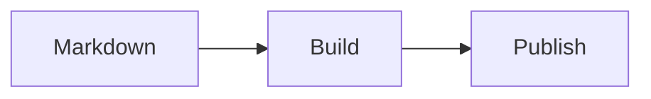

# sorakondo — Portfolio & Field Notes

Astroによる静的ポートフォリオ・技術ブログです。記事とメモはMarkdown/MDXファイルとしてGit管理し、mainへのpushでGitHub Pagesに公開します。CMS・データベース・実行時サーバーは不要です。

初期コンテンツはデモです。経歴・専門分野・研究実績を確認したものではありません。プロフィール・SNS・研究テーマは `src/site.ts`、プロジェクトは `src/content/projects/` を差し替えてください。元のHTML/CSSは `archive/original/` に保存しています。

## 使用技術

Astro 7 / TypeScript strict / Tailwind CSS v4（Viteプラグイン）/ Content Collections + Zod / MDX / Shiki / remark-math + rehype-katex / rehype-mermaid / Pagefind / RSS / Sitemap。

Astro 7の公式Unified Markdown処理系（`@astrojs/markdown-remark`）を明示し、remark/rehypeプラグインを使用しています。TypeScriptは `astro check` がサポートする6系を採用しています。MermaidはPlaywright Chromiumでビルド時にSVG化し、Mermaid本体をブラウザーに配信しません。Reactは使用していません。検索UIは検索ページでのみ読み込みます。

## セットアップと開発

Node.js 24以上と `package.json` 指定のpnpmを用意してください。日常の操作には [@antfu/ni](https://github.com/antfu-collective/ni) を使用します。`packageManager` と `pnpm-lock.yaml` からpnpmを自動判定するため、既存のlockfileとscriptsをそのまま利用できます。

```powershell
npm install --global pnpm@11.11.0 @antfu/ni

# PowerShellのみ：組み込みのNew-Itemエイリアスとの衝突を解除
Remove-Item Alias:ni -Force -ErrorAction Ignore

nci
na exec playwright install chromium
nr dev
```

Linux/WSLでは上記の `Remove-Item` 行は不要です。PowerShellではこの行を `$PROFILE` に追加すると次回起動時も有効になります。シェル設定は各自の環境で変更してください。

`ni` は依存関係のインストール、`nci` はlockfileを固定したインストール、`nr` はプロジェクトのscript実行、`na exec` はローカルツールの実行に使います。`ni` はグローバルCLIとして導入し、サイトの依存パッケージには追加しません。

| 操作 | ni系コマンド | 対応するpnpmコマンド |
| --- | --- | --- |
| 依存関係のインストール | `ni` | `pnpm install` |
| lockfile固定インストール | `nci` | `pnpm install --frozen-lockfile` |
| 開発 | `nr dev` | `pnpm dev` |
| 型チェック | `nr check` | `pnpm check` |
| ビルド | `nr build` | `pnpm build` |
| プレビュー | `nr preview` | `pnpm preview` |
| 投稿作成 | `nr new:blog` | `pnpm new:blog` |

GitHub Actionsでは `packageManager` 指定のpnpmとlockfile固定インストールを直接使用します。

LinuxでChromiumの共有ライブラリが不足する場合は `na exec playwright install --with-deps chromium` を使用してください。ブラウザーは**図のビルドにのみ**必要です。新しい環境やPlaywright更新後は再インストールしてください。Linuxで日本語の図が文字化けする場合は `fonts-noto-cjk` 等の日本語フォントをインストールしてください。CIにも日本語フォントを設定しています。

`nr dev` はホットリロードに対応します。公開状態を揃えるため、下書きは開発時も表示しません。確認したい記事は一時的に `draft: false` とし、コミット前に元へ戻してください。Pagefindは本番ビルドで生成するため、検索は `nr build` → `nr preview` で確認します。

## 記事・メモを追加する

```powershell
nr new:blog
```

投稿はすべて `src/content/blog/` に保存し、`/blog/` に表示します。旧 `/articles/`・`/notes/` の公開済みサンプルURLは対応するBlogへ転送します。

タイトル・slug・タグを対話入力します。英語タイトルからはslug候補を生成し、日本語タイトルには英数字slugを指定できます。タグはカンマ区切りです。生成先を表示し、既存の `.md` / `.mdx` を上書きしません。デフォルトは下書きです。公開日はUTCの当日を設定します。

```yaml
---
title: "KLayoutの操作Tips"
description: "何についてのメモか、短い説明"
pubDate: 2026-10-20
updatedDate: 2026-10-20
tags: ["KLayout", "Tips"]
draft: true
---
```

`updatedDate` は任意（公開日以降）、他のメタデータはスキーマで検証します。`draft` 未指定も下書き扱いです。公開前に `draft: false` に変更してください。下書きは詳細URL・一覧・タグ・RSS・サイトマップ・検索に含まれません。これはGitリポジトリのソースを非公開にする機能ではありません。

- `src/content/blog/klayout-tips.md` → `/blog/klayout-tips/`
- `src/content/blog/git/example.md` → `/blog/git/example/`
- `.mdx` も同じ規則。拡張子はURLに含まれません。
- ファイル名・ディレクトリ名は英小文字・数字・ハイフンを使用します。
- 公開後はファイル名を保持してください。`.md` と `.mdx` に同じslugを重複させないでください。
- タグページは公開コンテンツから自動生成されます。日本語タグも使用できます。

## Markdownの記述ルール

記事タイトルはFrontmatterから描画するので、本文は `## 見出し` から始めます。h2・h3から目次を生成します。コードフェンスに `python`、`c`、`cpp`、`typescript`、`bash`、`powershell`、`verilog` などの言語名を付けてください。Shikiはライト・ダークの両方に対応します。

数式はインライン `$f = 1/T$`、別行の `$$` で囲んだブロックに対応します。表、引用、箇条書きは通常のMarkdownで記述できます。

````markdown

````

Mermaid図の前に説明文を書き、`accTitle` / `accDescr` を指定してください。SVGはライトのキャンバスを維持し、どちらの配色でも文字が読めるようにしています。ソースは信頼する著者が管理する前提です。

MDXでAstroコンポーネントをimportできます。`mdx-example.mdx` を参考にしてください。通常はMarkdownだけで運用できます。

## 画像・動画

画像は `src/assets/` または記事近くのディレクトリに配置し、Markdownから相対参照します。Astroが出力先を管理します。

```markdown

```

`public/` は加工しないアセット用です。base pathを変更する可能性がある場合、MDXで `url` を使います。

```mdx
import {url} from '../../lib/content';
<video controls preload="metadata" src={url('videos/demo.mp4')} aria-label="デモ動画" />
```

大きな動画は外部ホスティングへのリンクを検討してください。プロジェクトの `repository` / `demo` は実在するURLを登録した場合だけ表示します。

## 型チェック・ビルド

```powershell
nr check
nr build
nr preview
```

`build` は静的HTML、日英対応のPagefind検索インデックス、RSS、サイトマップを `dist/` に生成します。Markdown/MDX間のslug重複も検出します。生成HTML内のローカルリンク・画像・見出しアンカーを検査し、不整合があれば失敗します。外部URLの到達性やMDX内の任意コードまでは検査しません。AstroはFrontmatterと参照画像も検証します。

## GitHub Pages

Git remoteに基づき `site.config.mjs` の初期値を `https://sorakondo.github.io`、baseを `/` としています。GitHubへのpush・公開はこの作業では実施していません。

1. GitHubのリポジトリ **Settings → Pages → Build and deployment → Source** を **GitHub Actions** にする。
2. 必要に応じてActions実行許可と `github-pages` environmentの保護ルールを確認する。
3. 内容を確認し、mainへcommit・pushする。**pushすると公開が開始されます。**
4. Actionsの「Deploy Astro to GitHub Pages」が成功したら公開URLを確認する。手動実行も可能。

ワークフローはpnpmのlockfileを固定してインストールし、型チェック → Mermaidビルド準備 → 静的ビルド・検索生成・リンク検査 → Pages artifact upload → deployの構成です。個別の秘密鍵やPATは不要です。Pages用トークン権限はdeployジョブに限定しています。

ユーザーページでは `/`、プロジェクトページでは `/repository/` をbaseにします。Actionsでは `configure-pages` のorigin・base_pathをビルドに渡すため、実際のPages設定に追従します。ローカルで試す場合：

```powershell
$env:SITE_URL = "https://sorakondo.github.io"
$env:BASE_PATH = "/example/"
nr build
nr preview
Remove-Item Env:BASE_PATH
Remove-Item Env:SITE_URL
```

Linux/WSLでは `SITE_URL=https://sorakondo.github.io BASE_PATH=/example/ nr build`。内部リンク・RSS・canonical・robots・検索アセットはbaseに対応しています。

## 独自ドメイン

1. GitHub PagesのCustom domainへ所有するドメインを設定する。
2. GitHubの案内に従いDNSを設定し、HTTPSを有効にする。
3. `site.config.mjs` の既定 `siteUrl` を独自ドメインへ、baseを `/` へ変更する。
4. 必要なら `public/CNAME` にドメイン名だけを記載する。
5. 再ビルドしcanonical・RSS・サイトマップを確認する。ActionsはPages設定のoriginを使用する。

## ディレクトリ

```text
.github/workflows/deploy.yml   # Pages自動デプロイ
archive/original/             # 旧ページの保管
public/                       # favicon・OG画像等
scripts/                      # 投稿CLI・生成リンク検査
src/
  assets/                     # 記事の画像
  components/                 # 一覧・カード・共通見出し
  layouts/                    # 共通レイアウト・記事レイアウト
  content/{blog,projects}/
  lib/content.ts              # 公開フィルター・URL・日付
  pages/                      # 静的ルート・RSS・robots
  styles/global.css           # 配色・タイポグラフィ・レスポンシブ
  content.config.ts           # Collections・Zodスキーマ
  site.ts                     # プロフィール・研究・リンク
site.config.mjs               # 公開URL・base path
astro.config.mjs              # Markdown・各インテグレーション
```

## 拡張

プロフィールを `src/site.ts` で差し替え、実績はMarkdownを追加します。配色・余白はCSS変数で調整できます。新しいCollectionは `content.config.ts` と静的ルートを追加してください。OG画像は `public/og.svg`（編集元）と `public/og.png`（共有用）を差し替えてください。ページ数が増えたら一覧のページネーション、研究テーマ別ページを追加できます。状態を持つ機能が必要になるまでは静的HTMLを維持してください。

実装時に確認した公式資料：[Astro Content Collections](https://docs.astro.build/en/guides/content-collections/)、[Tailwind](https://docs.astro.build/en/guides/styling/)、[Astro GitHub Pages](https://docs.astro.build/en/guides/deploy/github/)、[GitHub Actions公式テンプレート](https://github.com/actions/starter-workflows/blob/main/pages/astro.yml)、[Pagefind](https://pagefind.app/docs/)、[rehype-mermaid](https://github.com/remcohaszing/rehype-mermaid)。Actionsのタグは各公式リポジトリでも確認しています。

ブラウザー検証は `nr build` → `nr preview` の後、別ターミナルで `node scripts/verify-site.mjs` を実行できます。サブパス時は第1引数にプレビューの完全URLを指定してください。初期サンプルのルート・数式・図・日英検索・下書き除外・レスポンシブ・テーマを検証するため、サンプルを削除したら検証対象も更新してください。
