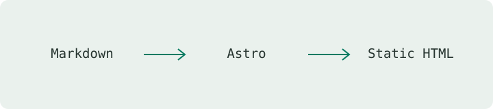

この記事は**表示確認用のデモ**です。実際の研究成果や経歴を示すものではありません。

## Markdownからはじめる

記事は `src/content/articles/` に、短いメモは `src/content/notes/` に保存します。ファイル名がそのままURLになるので、公開後は変更しない運用がおすすめです。



## コードを記録する

Pythonのサンプル。コードはShikiでハイライトされ、長い行は横にスクロールできます。

```python
from statistics import mean

samples = [1.2, 1.4, 1.3, 1.5]
print(f"Average: {mean(samples):.2f}")
```

### 型のあるコード

```typescript
type Measurement = { time: number; value: number };
const sample: Measurement = { time: 0, value: 1.2 };
```

## 数式を書く

インライン数式は $f = 1/T$ のように記述できます。平均は次のように表せます。

$$
\bar{x} = \frac{1}{N}\sum_{i=1}^{N} x_i
$$

## 流れを図にする

次のMermaid図はビルド時にSVGへ変換されます。図の直前に説明を書き、`accTitle` と `accDescr` も指定してください。


## 表と引用

| 種類 | 保存先 | 用途 |
| --- | --- | --- |
| Articles | `articles/` | まとまった技術記事 |
| Notes | `notes/` | 短いメモ・Tips |

> 小さな発見も、あとから再現できるかたちで残す。

関連メモ：[Gitで差分を確認する](../../notes/git-diff-tips/)

## 公開前の確認

- タイトルと説明を記入する
- 公開してよい内容か確認する
- `draft: false` に変更する
- `pnpm check` と `pnpm build` を実行する
